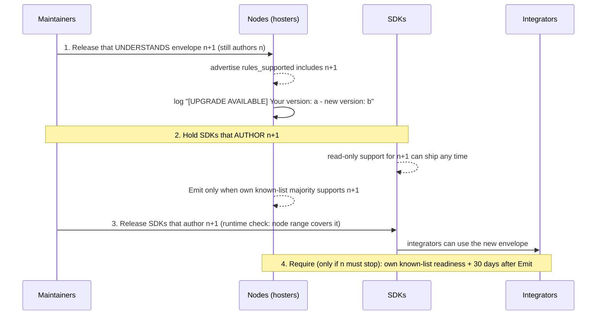

# Version Rollout

**Status:** Partially implemented — version awareness is live; rules-version activation, signed release manifests, and auto-update are Planned

No party can force an operator to upgrade. Self-hosting with no central gatekeeper is deliberate, so the network has to work with permanent version skew. This page describes the version axes, the standing compatibility rule, and the node-to-node version awareness that exists.

## Three version axes

Conflating them is the real failure mode.

- **Event-schema version:** payload shape per event kind, additive only.
- **Wire and API version:** HTTP endpoint shapes and mirror-sync data types.
- **Settlement and crypto version:** hash algorithm, signature scheme, and head and Merkle format. Mixed versions on the same `network_id` need the [planned activation model](#rules-version-and-activation) so witnesses understand new rules before authors emit them.

## Standing rule for the wire and API axis

Ordinary Y/Z releases are additive and stay wire-compatible with the previous version. Never remove, rename, or repurpose a field or endpoint outright; add alongside and deprecate slowly. One exception was taken once, before the protocol repository became public: a terminology generalization renamed some request and response fields and dropped a compatibility route family, knowingly, because at the time every consumer lived in one repository and was updated in the same change. That argument no longer exists. An actual breaking (X) rules-version boundary is the exception to ordinary compatibility, handled by the [planned version-mismatch mechanism](#rules-version-and-activation) specified in [ADR 0797](../decisions/0797-decision-safe-failure-behavior-for-sdk-node-requests-across-a-breaking-x-version-boundary.md).

## Cross-cutting invariant

A version claim is never trusted for anything cryptographic or used to grant elevated trust or capability. It is a compatibility and availability signal. The worst case of a forged claim is a self-inflicted availability change (wrongly excluded from, or wrongly kept in, gossip), never elevated trust or bypassed verification. Every settlement operation stays independently verified regardless of what either side claims.

## What exists

- The mirror-sync wire format carries an additive version field, so an older peer's response without it still decodes. An incompatible version produces a structured log line and a distinct error, never a panic or an undifferentiated decode failure.
- The version a node reports is a compile-time constant, never a runtime setting, which closes the trivial "set a config value" spoofing path. This is not cryptographic non-forgeability: a recompiled binary can hardcode anything. Genuine non-forgeability needs a signed release manifest, which does not exist.
- A minimum-supported-peer-version floor is baked into the binary. A peer below it is excluded from the peer table and gossip. An environment setting can only raise the floor, never lower it. Exclusion is reversible: a peer that upgrades is re-admitted on its next announce.
- `GET /nodes/status` reports the node's protocol version, its roles, and, when known through gossip, a `stale` flag. The flag is a self-diagnostic hint only; nothing reads it to change behavior.

## Rules version and activation

**Status:** Planned — the model is decided in [ADR 1152](../decisions/1152-decision-consensus-rule-changes-ship-in-three-steps-driven-by-readiness-instead-of-a-calendar.md) and is not implemented.

`rules_version` is an integer governing validity, independent of the build's semver, the signed layout version, and the event-kind version. A build supports a range: announce and `/info` advertise `rules_supported` and the version it authors with, `rules_emitting`. Every signed structure declares the rules it was authored under and is validated under those rules forever; raising the version does not invalidate an existing event or head.

A validity change rolls out in three steps:

1. **Understand:** release N validates `n+1` and advertises support, but still authors with `n`. Its `/info` and release-note notice gives at least 30 days' warning before an enforcing release; it promises no calendar date.
2. **Emit:** release N+1 lets an author emit `n+1` once a strict majority of its own known witness list advertises support. The normal release process enforces the minimum 30-day gap after Understand. There is no global height, coordinator, or activation key.
3. **Require (optional):** a verifier stops accepting new events authored under `n` only when at least `max(strict majority, ceil(4/5 of its own known-list size))` is emitting `n+1`, and in a release published at least 30 days after Emit. At the default list size this is 4 of 5. Additive changes can stop after Emit.

A node encountering unsupported rules fails closed: it does not validate, store or serve as verified, or cosign them. It reports `upgrade required` with the rules version, keeps serving supported history, and catches up from peers after upgrading. Ordinary releases that do not change validity stay outside this process.

Planned SDK-to-node protection ([ADR 0797](../decisions/0797-decision-safe-failure-behavior-for-sdk-node-requests-across-a-breaking-x-version-boundary.md)): every request carries `rules_version`, in the body for writes (inside the signed bytes for signed objects) and a header or query parameter for reads. The node rejects an unsupported version with a typed error naming its supported range; SDKs send the version automatically and surface typed too-old and too-new errors. Unsigned claims that a newer release exists are not rebroadcast.

## Emergency upgrades

**Status:** Planned — [ADR 1154](../decisions/1154-decision-emergency-upgrade-path-for-a-fix-that-cannot-wait-for-the-activation-window.md) allows an ordinary release to skip only the 30-day minimum gap. It uses the normal release-signing threshold or a higher one and a signed advisory linked to a public decision record; there is no single-key override. It may tighten validity for new events, but cannot loosen it or retroactively invalidate accepted events. Manifests and advisories enter an append-only public release log checked independently by nodes.

Auto-update is independently configurable for emergency, security, and normal releases. The decided defaults auto-apply emergency and security releases and leave normal releases manual. Apply retains the previous binary, runs migrations transactionally, health-checks the new binary, and rolls back on failure; the previous binary must still run on the new schema. Each automatic update leaves a notice file, an `/info` banner, a log line, and local update history. A node that misses the update stays visibly behind and catches up after upgrading.

## Rolling out an envelope change

**Proposed.** How a change to the [ledger entry envelope](../../protocol/ledger-entry-envelope.md) would reach the network, following the format rules in [ADR 1153](../decisions/1153-decision-every-signed-and-ledger-format-is-versioned-and-forward-compatible-before-launch.md) and the [planned activation model](#rules-version-and-activation). Nodes first understand the new layout while still authoring the old one; SDKs that author it are held until nodes can accept it.

Held SDK releases supplement the runtime check against the connected node's advertised range ([ADR 0797](../decisions/0797-decision-safe-failure-behavior-for-sdk-node-requests-across-a-breaking-x-version-boundary.md)); neither replaces the author's known-list readiness gate for Emit ([ADR 1152](../decisions/1152-decision-consensus-rule-changes-ship-in-three-steps-driven-by-readiness-instead-of-a-calendar.md)).

## Not built or decided against

- Planned, gated on release signing: per-category auto-update for self-hosted nodes, with operator opt-in and opt-out as described under [emergency upgrades](#emergency-upgrades).
- Decided against for now: capability-based request forwarding (an outdated node relaying to a capable peer), because it adds a trust hop with no accountability story.
- Reserved and undesigned: a hard-fork escape hatch (a new `network_id` while the old one keeps running) for a genuinely incompatible cryptographic change.

## Implementation

Status: Partially implemented, as above. Version handling is in the [server crate](https://github.com/avalon-initiative/avalon-protocol/tree/main/crates/server) of avalon-protocol.

## Related

- [Nodes](README.md)
- [Ledger entry envelope](../../protocol/ledger-entry-envelope.md)
- [Discovery and peering](discovery-and-peering.md)
- [Protocol events](../../protocol/protocol-events.md) (event-schema versioning)
